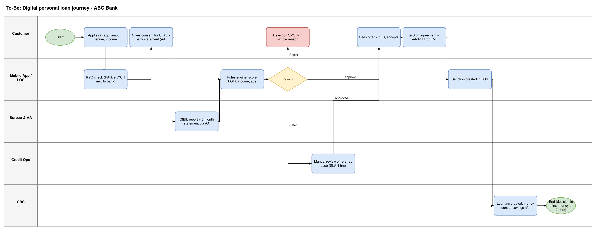
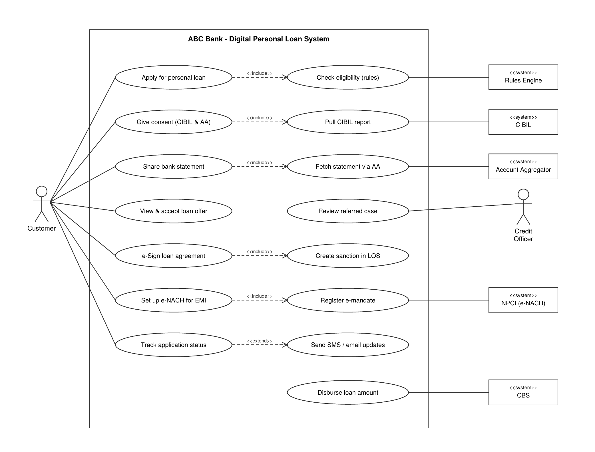

# Digital Personal Loan Journey (Business Analysis Project)

A business analysis project on moving a bank's personal loan process from the branch into the mobile app. Today the customer fills a paper form, hands over salary slips and a printed bank statement, and waits 3-5 working days while the file moves between the branch and Credit Ops. The aim is a decision in minutes for low-risk customers and money in the account within 24 hours, without taking extra credit risk.

ABC Bank is made up, but the journey follows how digital personal loans work in India: CIBIL credit check, bank statement through an Account Aggregator, rules engine with a Credit Ops review queue, KFS with APR, Aadhaar e-Sign, e-NACH for EMIs and disbursal only to the borrower's own account.

## What's in this repo

| File | What it is |
|---|---|
| `Personal_Loan_BA_Project.pdf` | Full project in one document (20 pages) |
| `AsIs_Process_Flow.png` | As-Is swimlane - branch loan process |
| `ToBe_Process_Flow.png` | To-Be swimlane - digital loan journey with approve / refer / reject |
| `Use_Case_Diagram.png` | UML use case diagram |
| `Personal_Loan_Wireframes.pdf` | 5 screens: application, consent, offer, KFS & e-Sign, disbursed |

## What I did

1. **Understanding the need** - current process, meetings with Product, Credit, Compliance and CBS teams, problem statement
2. **BRD** - objectives, scope, stakeholders, As-Is / To-Be, 14 business requirements, 6 compliance requirements, risks, KPIs, open questions
3. **FRD** - 27 functional requirements across 4 modules, credit rules (CIBIL bands, FOIR, income), error messages, NFRs, traceability
4. **Process flows** - As-Is and To-Be swimlanes
5. **Wireframes** - 5 low-fidelity screens with notes linked to the FRD
6. **Use case diagram** - customer, Credit Officer and external systems (CIBIL, AA, NPCI, CBS)
7. **User stories** - 10 stories with acceptance criteria
8. **UAT** - 14 test cases, defect log

## To-Be process

## Use case diagram

## Key targets set in the BRD

- Time to decision: 2-3 days -> under 5 minutes for auto-approved cases
- Time to disbursal: 3-5 days -> under 24 hours after e-Sign
- 60% of applications decided with no manual step
- Early defaults no higher than the branch loan book

## Tools

MS Word · Excel

---
*Self-initiated portfolio project. ABC Bank Ltd is fictional, and all names and figures are my own.*
